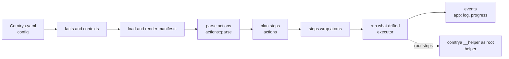

# Architecture

A map of the code, to find where to make a change. The details live in the module docs on
[docs.rs](https://docs.rs/comtrya-lib).

## Crates

| Crate | What it is |
|---|---|
| `lib` (`comtrya-lib`) | Everything comtrya does: load manifests, gather facts, plan and run steps |
| `app` (`comtrya`) | The command line around the library: arguments, config, output |
| `compat` | Tests only: loads manifests with this checkout and with the last release and compares them |
| `jsonschemagen` | Prints the JSON schema of manifests, published as comtrya.dev/schema.json |
| `xtask` | `cargo xtask check`: fmt, clippy, tests, docs and MSRV, like CI |

## The path of `comtrya apply`

1. **Config and facts.** `config` reads `Comtrya.yaml`. `contexts` gathers the facts about the
   system (user, OS, environment, variables) as `Facts`, and turns them into the `Contexts` that
   templates and `where` conditions see.
2. **Load.** `manifests` finds the manifest directory, local or a git repository, renders each
   file's templates and names each manifest after its path.
3. **Parse.** `actions::parse` picks each action by its `action` key from the registry, and takes
   `where`, `variants` and `continue_on_error` itself.
4. **Plan.** Each action picks the variant that applies and plans steps. Planning changes nothing.
5. **Steps and atoms.** A step wraps one atom, the smallest change, and says who makes it: the
   user or root.
6. **Run.** `executor` runs the manifests, dependencies first. A step runs only when its atom's
   check says the system differs. What happens goes out as events, and the app shows them as
   log lines and a progress line.

## To change X, look at Y

| To change | Look at |
|---|---|
| An action, or add one | `lib/src/actions/` and the `actions!` table in `lib/src/actions/registry.rs` |
| How actions are read from YAML or TOML | `lib/src/actions/parse.rs` |
| A package manager | `lib/src/actions/package/providers/` |
| An atom, the smallest change | `lib/src/atoms/` |
| What a step is | `lib/src/steps/mod.rs` |
| Facts and the keys templates see | `lib/src/contexts/facts.rs`, `lib/src/contexts/mod.rs` |
| `include_variables` sources | `lib/src/contexts/variable_include/` |
| `sudo`, `doas` or `run0` | `lib/src/contexts/privilege.rs` |
| Finding, loading and naming manifests | `lib/src/manifests/` |
| Manifests from git | `lib/src/manifests/providers/git/` |
| Warnings about unknown keys | `lib/src/manifests/unknown_keys.rs` |
| Order, dependencies, `--jobs` | `lib/src/executor/graph.rs`, `lib/src/executor/schedule.rs` |
| Running a manifest's steps | `lib/src/executor/run.rs` |
| What a run reports | `lib/src/executor/event.rs` |
| The privileged helper | `lib/src/helper.rs` |
| Template functions | `lib/src/tera_functions/mod.rs` |
| Commands and arguments | `app/src/main.rs`, `app/src/commands/` |
| The output of `apply` | `app/src/commands/apply/log.rs`, `app/src/commands/apply/progress.rs` |
| `Comtrya.yaml` | `lib/src/config/mod.rs`, `app/src/config/` |
| User documentation | `docs/src/` |
| Compatibility with released manifests | `compat/tests/v1.rs` |

## Good to know

- **Planning changes nothing.** Actions only plan steps; atoms make the changes. That's what makes
  `--dry-run` and `status` possible.
- **A step runs only when needed.** Each atom checks first whether the system is in sync or has
  drifted, and only drifted steps run. A dry run also knows a path an earlier step would make.
- **Root steps use one helper.** Programs run through the privilege provider. Other root atoms,
  like writing a file below `/etc`, go to `comtrya __helper`, started once per run through the
  same provider, so the password is asked for once.
- **One tokio runtime.** DNS, downloads, `include_variables` and the update check run on
  `lib/src/runtime.rs`. Don't build another one.
- **TLS needs a provider.** reqwest uses ring, installed by
  `comtrya_lib::tls::install_crypto_provider`. Code that talks to the network calls it first,
  or reqwest panics.
- **Errors are typed.** Each module has `thiserror` errors. A message doesn't repeat its source;
  `comtrya_lib::error_chain` prints the whole chain.
- **Commands in tests are faked.** Read-only commands go through `lib/src/runner.rs`, so tests
  don't depend on the machine.
