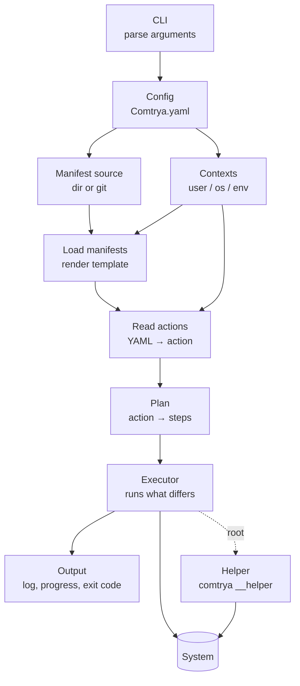

# Architecture

A map of the code, to find where to make a change. The details live in the module docs on
[docs.rs](https://docs.rs/comtrya-lib).

## Crates

| Crate | What it is |
|---|---|
| `lib` (`comtrya-lib`) | Everything comtrya does: load manifests, gather facts, plan and run steps |
| `app` (`comtrya`) | The command line around the library: arguments, config, output |
| `compat` | Tests only: loads manifests with this checkout and with the last release and compares them |
| `jsonschemagen` | Prints the JSON schema of manifests, published as comtrya.dev/schema.json |
| `xtask` | `cargo xtask check`: fmt, clippy, tests, docs and MSRV, like CI |

## The path of `comtrya apply`

- **CLI.** What the user typed: the manifest directory (`-d`), the config file (`-c`), which
  manifests (`-m`) or labels (`-l`) to run, extra variables (`-D key=value`), `--dry-run` and the
  number of parallel jobs (`-j`). In `app/src/main.rs` and `app/src/config/`.
- **Config.** `Comtrya.yaml` (or `.yml`/`.toml`): where the manifests are, variables, the
  privilege program and the default package provider. In `lib/src/config/`.
- **Contexts.** Everything a manifest can ask about the machine and the run: the user, the OS,
  environment variables, variables from the config and `-D`, and from `include_variables`. In
  `lib/src/contexts/`.
- **Manifest source.** A local directory, or a git repository that is cloned into a cache. In
  `lib/src/manifests/providers/`.
- **Load manifests.** Finds the manifest files, fills in their templates (`{{ user.name }}`) with
  the contexts, and names each manifest after its path: `dev/git.yaml` is `dev.git`. In
  `lib/src/manifests/`.
- **Read actions.** Turns each entry of a manifest's `actions:` list, like `action: file.copy`,
  into a typed action. A `where:` condition or `variants:` decides, with the contexts, whether
  and how the action applies. In `lib/src/actions/parse.rs`.
- **Plan.** Each action works out the small changes it needs, called steps: "create the
  directory", "copy the file". Each step holds one atom, the change itself, and says whether the
  user or root makes it. Nothing is changed yet, which is how `--dry-run` works. In
  `lib/src/actions/`, `lib/src/steps/` and `lib/src/atoms/`.
- **Executor.** Runs the manifests, the ones they depend on first. Before each step, it checks
  whether the system already looks right, and only runs the steps where it doesn't. In
  `lib/src/executor/`.
- **Helper.** Steps that need root, like writing below `/etc`, go to one `comtrya __helper`
  started through `sudo` (or `doas`, `run0`), so the password is asked for once. In
  `lib/src/helper.rs`.
- **Output.** The executor reports what happens as events; the app shows them as log lines and a
  progress line, and sets the exit code. In `app/src/commands/apply/`.

## To change X, look at Y

| To change | Look at |
|---|---|
| An action, or add one | `lib/src/actions/` and the `actions!` table in `lib/src/actions/registry.rs` |
| How actions are read from YAML or TOML | `lib/src/actions/parse.rs` |
| A package manager | `lib/src/actions/package/providers/` |
| An atom, the smallest change | `lib/src/atoms/` |
| What a step is | `lib/src/steps/mod.rs` |
| Facts and the keys templates see | `lib/src/contexts/facts.rs`, `lib/src/contexts/mod.rs` |
| `include_variables` sources | `lib/src/contexts/variable_include/` |
| `sudo`, `doas` or `run0` | `lib/src/contexts/privilege.rs` |
| Finding, loading and naming manifests | `lib/src/manifests/` |
| Manifests from git | `lib/src/manifests/providers/git/` |
| Warnings about unknown keys | `lib/src/manifests/unknown_keys.rs` |
| Order, dependencies, `--jobs` | `lib/src/executor/graph.rs`, `lib/src/executor/schedule.rs` |
| Running a manifest's steps | `lib/src/executor/run.rs` |
| What a run reports | `lib/src/executor/event.rs` |
| The privileged helper | `lib/src/helper.rs` |
| Template functions | `lib/src/tera_functions/mod.rs` |
| Commands and arguments | `app/src/main.rs`, `app/src/commands/` |
| The output of `apply` | `app/src/commands/apply/log.rs`, `app/src/commands/apply/progress.rs` |
| `Comtrya.yaml` | `lib/src/config/mod.rs`, `app/src/config/` |
| User documentation | `docs/src/` |
| Compatibility with released manifests | `compat/tests/v1.rs` |

## Good to know

- **Planning changes nothing.** Actions only plan steps; atoms make the changes. That's what makes
  `--dry-run` and `status` possible.
- **A step runs only when needed.** Each atom checks first whether the system is in sync or has
  drifted, and only drifted steps run. A dry run also knows a path an earlier step would make.
- **Root steps use one helper.** Programs run through the privilege provider. Other root atoms,
  like writing a file below `/etc`, go to `comtrya __helper`, started once per run through the
  same provider, so the password is asked for once.
- **One tokio runtime.** DNS, downloads, `include_variables` and the update check run on
  `lib/src/runtime.rs`. Don't build another one.
- **TLS needs a provider.** reqwest uses ring, installed by
  `comtrya_lib::tls::install_crypto_provider`. Code that talks to the network calls it first,
  or reqwest panics.
- **Errors are typed.** Each module has `thiserror` errors. A message doesn't repeat its source;
  `comtrya_lib::error_chain` prints the whole chain.
- **Commands in tests are faked.** Read-only commands go through `lib/src/runner.rs`, so tests
  don't depend on the machine.
